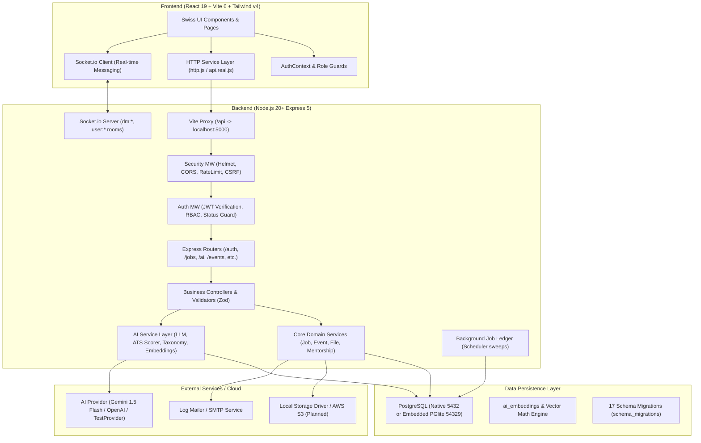

# Complete Project Context & Codebase Audit — Alumni Network Portal

> **Document Type:** Comprehensive Architectural Audit & Ground-Truth System Context  
> **Repository Root:** `Alumni-Network`  
> **Audit Timestamp:** 2026-10-12  
> **Status:** Fully Analyzed & Empirically Verified  

---

## 1. Project Overview

- **Project Name:** Alumni Network Portal (**Verified**)
- **Target Institution:** University & Engineering College Ecosystem (**Verified** in `seed-demo.js` and `client/src/index.css`)
- **Core Purpose:** A centralised, multi-role web platform designed to bridge current undergraduate students, alumni graduates, faculty/professors, and university administrators into a cohesive professional and academic ecosystem. (**Verified**)
- **Problem Addressed:** Eliminating fragmented communication channels, outdated contact registries, disconnected job boards, and opaque mentorship discovery. It provides verified institutional identity, structured career mentorship, active job postings, real-time messaging, campus events, endowment donations with tax receipts, and embedded AI career intelligence. (**Verified**)

### User Roles & Intended Personas (**Verified** from `database/seeds/001_roles.sql`, `016_roles_professor.sql`, `client/src/utils/roles.js`)
1. **STUDENT:** Enrolled undergraduates seeking internships, full-time employment, alumni mentorship, resume ATS optimization, career roadmap milestones, and campus event participation.
2. **ALUMNI:** Verified graduates providing mentorship, posting industry job openings, participating in reunions, networking with peers, and donating to endowment funds.
3. **PROFESSOR / FACULTY:** Academic department leaders and mentors advising student rosters, coordinating campus research initiatives, publishing academic announcements, and liaising with industry alumni.
4. **ADMIN (Administrator / Staff / Moderator):** University operations team governing account verifications, role management, job posting moderation, event publication, content moderation ledgers, and platform audit logs.

---

## 2. Current Repository and Git Status

- **Active Branch:** `main` (**Verified** via `git status`)
- **Remote Tracking:** `origin/main` (**Verified**)
- **Synchronization Status:** Synchronized — Local `main` is completely up-to-date with `origin/main` (0 commits ahead, 0 commits behind). (**Verified**)
- **Latest Commit Hash & Subject:** `5707223` — `chore(backend): complete system audit testing and production fixes` (Author: Atharva Tayade, Sat Oct 10 14:30:51 2026 +0530) (**Verified**)
- **Local Working Tree Status:** Clean working directory with exactly one untracked artifact: `server/server/` (**Verified** via `git status --short`).
  - *Origin of `server/server/`:* Generated at runtime during test/upload runs when scripts executed within `server/` resolved `LOCAL_UPLOAD_DIR=./server/uploads` relative to the process working directory.
- **Other Branches Present:**
  - `backup/pre-main-sync-20261009-205000` (Local branch) (**Verified**)
  - `feature/ai-job-readiness-and-career-roadmap` (Local branch) (**Verified**)
  - `remotes/origin/main` (Remote tracking branch) (**Verified**)
- **Merges & Conflict Signs:** No unfinished merges, rebase markers, or conflict artifacts exist. (**Verified**)
- **Staleness of Legacy Documentation:**
  - Root `README.md` is **Severely Outdated** (**Verified**): Claims the repository is only a "foundation build" with authentication, jobs, mentorship, events, payments, and admin unbuilt.
  - Root `BRAIN.md` is **Partially Outdated** (**Verified**): Stated that AI was planned as an external FastAPI service in Phase 5 and Events/Admin were unbuilt; in reality, all four AI features, Events, and Admin are fully implemented natively inside Node.js Express.
  - `database/migrations/README.md` is **Partially Outdated** (**Verified**): Covers migrations only up to 013, omitting migrations 014 through 017.

---

## 3. Technology Stack and Versions

### Client Stack (`client/package.json`) (**Verified**)
- **Runtime / Language:** ECMAScript Modules (ESM), JavaScript (ES2023+)
- **UI Framework:** React `^19.1.0` (`react`, `react-dom`)
- **Routing:** React Router DOM `^7.6.0` (Client-side nested route architecture)
- **Bundler & Dev Server:** Vite `^6.3.5` (running `vite v6.4.3`) with `@vitejs/plugin-react` `^4.4.1`
- **Styling Engine:** Tailwind CSS `^4.1.7` via `@tailwindcss/vite` plugin
- **Design System:** Custom Swiss Dev UI System (Strict 1px borders, high-contrast monochrome palette with `#ff6600` accent, monospace JetBrains Mono labels, zero drop-shadows)
- **Unit / Component Test Runner:** Vitest `^5.0.3` (installed in devDependencies)
- **Linter:** ESLint `^9.25.0` with `@eslint/js`, `eslint-plugin-react-hooks`, `eslint-plugin-react-refresh`

### Server Stack (`server/package.json`) (**Verified**)
- **Runtime:** Node.js `>=20` (Audited on Node `v24.13.0`)
- **Web Framework:** Express `^5.1.0` (RESTful architecture, custom router controllers)
- **Real-Time WebSockets:** Socket.io `^4.8.1` (Authenticated via JWT handshake)
- **Database Driver:** `pg` (node-postgres) `^8.16.0` (Connection pooling via `pg.Pool`)
- **Embedded Local Database:** `@electric-sql/pglite` `^0.5.8` + `@electric-sql/pglite-socket` `^0.2.11` (Zero-Docker in-memory/file-backed PostgreSQL server on port 54329)
- **Authentication & Cryptography:** `bcrypt` `^6.0.0`, `jsonwebtoken` `^9.0.2`, Node native `node:crypto`
- **Validation Engine:** Zod `^3.25.0` (Comprehensive schemas on route bodies, queries, and params)
- **Security Middleware:** `helmet` `^8.1.0`, `cors` `^2.8.5`, `cookie-parser` `^1.4.7`, `express-rate-limit` `^7.5.0`
- **File Upload & Parsing:** `multer` `^2.0.0`, `pdf-parse` `^2.4.5` (PDF extraction), `mammoth` `^1.13.0` (DOCX extraction)
- **Logging & Diagnostics:** `morgan` `^1.10.0`, custom structured JSON logging
- **Test Framework:** Node.js Native Test Runner (`node --test`), `supertest` `^7.1.0`

---

## 4. System Architecture

### Architectural Topology (**Verified**)
The platform operates as a decoupled client-server architecture with an Express REST API backend, PostgreSQL database persistence, Socket.io bidirectional communication, and local or cloud AI/LLM providers.



---

## 5. Directory Structure

```text
Alumni-Network/
├── client/                               # Frontend application package
│   ├── public/                           # Static public assets
│   ├── src/
│   │   ├── assets/                       # UI assets & logos
│   │   ├── components/                   # Swiss UI primitives & helpers
│   │   │   ├── PagePlaceholder.jsx      # Generic fallback placeholder
│   │   │   ├── RoleSwitcher.jsx         # 1-click role switcher simulation
│   │   │   └── ui.jsx                   # Atomic Swiss UI design components
│   │   ├── context/                      # Global context providers
│   │   │   └── AuthContext.jsx          # Session state, user credentials, login/logout
│   │   ├── data/                         # Client-side fallback entities & fixtures
│   │   │   ├── index.js / mock-db.js    # LocalStorage-backed reactive mock DB
│   │   │   └── [alumni, jobs, etc.].js  # Persona fixtures
│   │   ├── layouts/
│   │   │   └── AppLayout.jsx            # Unified shell with desktop/mobile navigation
│   │   ├── pages/                       # All 25 application views & dashboards
│   │   ├── routes/
│   │   │   ├── guards.jsx               # RequireAuth, RequireAnonymous, RequireRoleAccess
│   │   │   └── index.jsx                # Route registry (28 total routes)
│   │   ├── services/
│   │   │   ├── api.js                   # Unified re-export façade
│   │   │   ├── api.real.js              # Production REST API connector (454 lines)
│   │   │   ├── ai.service.js            # AI Career Assistant & ATS API client
│   │   │   ├── http.js                  # Fetch wrapper, interceptors, CSRF & 401 retry
│   │   │   └── *.service.js             # Legacy mock service modules
│   │   ├── utils/
│   │   │   ├── permissions.js           # RBAC permissions matrix & role navigation
│   │   │   └── roles.js                 # Role constant definitions
│   │   ├── App.jsx                      # App root router mount
│   │   ├── index.css                    # Tailwind v4 theme definitions
│   │   └── main.jsx                     # Entry React 19 mount point
│   ├── package.json                     # Client scripts and dependencies
│   └── vite.config.js                   # Vite configuration & proxy rules
├── database/                             # Database definition & migration runner
│   ├── migrations/                      # 17 sequential migration SQL files + down files
│   ├── schema/                          # Database schema documentation
│   └── seeds/                           # Base seed definitions (001_roles.sql)
├── docs/                                 # Technical architecture, API, and test plans
├── server/                               # Backend server package
│   ├── scripts/                         # Operational verification & benchmarking scripts
│   ├── src/
│   │   ├── config/                      # Database pool, env parser, embedded DB start
│   │   ├── controllers/                 # Express controller handlers
│   │   ├── middleware/                  # Auth, RBAC, RateLimit, Security, Upload, Validation
│   │   ├── models/                      # Database models and SQL query mappers
│   │   ├── routes/                      # Route module registrations
│   │   ├── services/                    # Business services (Jobs, Events, Mentorship, File)
│   │   │   └── ai/                      # AI Intelligence subsystem (13 modules)
│   │   │       ├── providers/           # Gemini, OpenAI, and Test providers
│   │   │       ├── aiProvider.js        # Provider factory & cache
│   │   │       ├── aiService.js         # Core orchestration service
│   │   │       ├── atsScorer.js         # Deterministic ATS scoring engine
│   │   │       ├── careerReadinessService.js # Skill gap & roadmap engine
│   │   │       ├── embeddingService.js  # Vector cosine similarity & embedding generation
│   │   │       ├── llmService.js        # LLM text & structured JSON invocation
│   │   │       ├── promptService.js     # System instructions & dynamic prompt builders
│   │   │       ├── resumeExtractor.js   # PDF & DOCX buffer extraction with Node 22 polyfills
│   │   │       ├── retrievalService.js  # Grounded PostgreSQL retrieval engine
│   │   │       └── skillTaxonomy.js     # 350+ categorized technical skills & benchmarks
│   │   ├── sockets/                     # Socket.io connection & real-time messaging
│   │   ├── utils/                       # Errors, crypto, logger, response formatting
│   │   ├── validators/                  # Zod request validators
│   │   └── app.js                       # Express app configuration & middleware pipeline
│   ├── tests/                           # 9 native Node.js test suites (501 tests)
│   ├── package.json                     # Server scripts and dependencies
│   └── server.js                        # Entry server listener, scheduler, and socket setup
├── .env.example                          # Environment variable specifications
├── .gitignore                            # Git exclusion rules
├── BRAIN.md                              # Historical project overview
├── docker-compose.yml                    # PostgreSQL 16 Docker Compose manifest
├── README.md                             # Repository introductory document
└── PROJECT_CONTEXT.md                    # Current complete project audit (This Document)
```

---

## 6. Frontend Architecture

### Routing & Route Protection (**Verified** in `client/src/routes/index.jsx` & `guards.jsx`)
- **Router Implementation:** React Router v7 (`react-router-dom`) with client-side history.
- **Route Guards:**
  - `<RequireAnonymous>`: Blocks authenticated users from `/login`, `/register`, `/forgot-password`, `/reset-password` and redirects them to `/dashboard`.
  - `<RequireAuth>`: Ensures `status === 'authenticated'`. Redirects unauthenticated users to `/login` preserving target location in `state.from`.
  - `<RequireRoleAccess>`: Reads current user's primary role via `canAccessRoute(user, path)`. If unauthorized, redirects to `/403`.
- **Primary Layout:** `AppLayout.jsx` wraps all authenticated views with a top navigation bar, Swiss status badges, responsive mobile slide-out drawer, and dynamic role-tailored links.

### State Management & HTTP Client (**Verified**)
- **Global State:** React Context (`AuthContext.jsx`) maintains the current user profile, authentication status (`'loading' | 'authenticated' | 'anonymous'`), session error, and unread notification counter.
- **HTTP Abstraction (`client/src/services/http.js`):**
  - Custom `fetch` wrapper targeting `/api` (proxied by Vite to `http://localhost:5000`).
  - Automatically attaches `Authorization: Bearer <accessToken>` stored in `sessionStorage` (`anp.accessToken`).
  - Reads `csrf_token` cookie and mirrors it in `x-csrf-token` header.
  - Intercepts `401 Unauthorized` responses and triggers transparent session refresh via `POST /api/auth/refresh` with concurrent request deduplication.
  - Automatically unwraps standardized `{ success, data, meta }` payloads and transforms error responses into typed `ApiError` instances.

---

## 7. Complete Page and Feature Inventory

| Page / Feature | File Path | User Roles Allowed | Actions & Workflows | Backend Integration Status | Data Source Type | Verification Level |
|---|---|---|---|---|---|---|
| **Landing Page** | `client/src/pages/Home.jsx` | Public | Explore portal features, review institutional KPIs, navigate to login or register | Complete | Static Swiss UI showcase | **Verified** |
| **Login** | `client/src/pages/Login.jsx` | Anonymous | Sign in with email/password, quick demo account switcher, link to password recovery | Complete | Real API: `POST /api/auth/login` | **Verified** |
| **Registration** | `client/src/pages/Register.jsx` | Anonymous | Register as Student, Alumni, or Professor with role-specific fields and validation | Complete | Real API: `POST /api/auth/register` | **Verified** |
| **Forgot Password** | `client/src/pages/ForgotPassword.jsx` | Anonymous | Request password reset token by email (anti-enumeration security) | Complete | Real API: `POST /api/auth/forgot-password` | **Verified** |
| **Reset Password** | `client/src/pages/ResetPassword.jsx` | Anonymous | Submit new password with secure token verification | Complete | Real API: `POST /api/auth/reset-password` | **Verified** |
| **Verify Email** | `client/src/pages/VerifyEmail.jsx` | Public | Confirm account email verification token | Complete | Real API: `GET /api/auth/verify-email` | **Verified** |
| **Dashboard** | `client/src/pages/Dashboard.jsx` | All Authenticated | Role-specific KPI metrics, quick actions, recommended jobs/mentors, event cards | Complete | Real API: `GET /api/profiles/me`, `/jobs`, `/events`, `/notifications` | **Verified** |
| **Directory** | `client/src/pages/Directory.jsx` | All Authenticated | Search alumni, filter by graduation year, industry, skills; view interactive map points | Complete | Real API: `GET /api/alumni`, `/api/profiles/directory` | **Verified** |
| **Alumni Profile** | `client/src/pages/AlumniProfile.jsx` | All Authenticated | View alumnus timeline, degree, verified badge, send connection request, start message thread | Complete | Real API: `GET /api/profiles/:id`, `POST /api/connections` | **Verified** |
| **Profile Settings** | `client/src/pages/Profile.jsx` | All Authenticated | Edit bio, skills, education, experience, social links, granular privacy toggles | Complete | Real API: `PATCH /api/profiles/me`, `/education`, `/experience`, `/privacy` | **Verified** |
| **Jobs Board** | `client/src/pages/Jobs.jsx` | All Authenticated | Browse jobs, view company profile, save jobs, apply with resume, manage applicant review | Complete | Real API: `GET/POST /api/jobs`, `/applications`, `/jobs/:id/save` | **Verified** |
| **Mentorship** | `client/src/pages/Mentorship.jsx` | All Authenticated | Discover available mentors, request mentorship, accept/decline requests, track active sessions | Complete | Real API: `GET/POST/PATCH /api/mentorship/*` | **Verified** |
| **Messages** | `client/src/pages/Messages.jsx` | All Authenticated | Direct 1-on-1 messaging, conversation list, real-time typing indicators and message sync | Complete | Real API: `GET/POST /api/conversations`, `/messages`, Socket.io | **Verified** |
| **Notifications** | `client/src/pages/Notifications.jsx` | All Authenticated | View in-app alerts, mark read, delete, manage notification preferences | Complete | Real API: `GET/PATCH/DELETE /api/notifications/*` | **Verified** |
| **Events Calendar** | `client/src/pages/Events.jsx` | All Authenticated | Browse events, filter by date/status, create event (alumni/faculty), RSVP | Complete | Real API: `GET/POST /api/events`, `/rsvp` | **Verified** |
| **Event Details** | `client/src/pages/EventDetails.jsx` | All Authenticated | View event venue/link, attendee roster, organizer notes, update RSVP | Complete | Real API: `GET /api/events/:id`, `/attendees` | **Verified** |
| **Resume Manager** | `client/src/pages/Resume.jsx` | Student, Admin | Upload PDF/DOCX resume, preview parsed text, view extracted skills, jump to ATS scan | Complete | Real API: `GET/POST/DELETE /api/profiles/me/resume` | **Verified** |
| **Donations Portal** | `client/src/pages/Donations.jsx` | Alumni, Admin | Select endowment funds, submit donation, generate 80G tax receipt, review donation history | Complete | Hybrid: Real API `/donations/*` with preset fund cards | **Verified** |
| **Faculty Students Roster** | `client/src/pages/Students.jsx` | Professor, Admin | Review student scholar list, career goals, readiness scores, and guidance notes | Partial | Real API `/profiles/directory` with mock fallback `db.students` | **Verified** |
| **Announcements** | `client/src/pages/Announcements.jsx` | Professor, Admin | Publish university-wide or department announcements with audience filters | Partial | Client-side mock `db.announcements` (No backend table) | **Verified** |
| **AI Career Assistant** | `client/src/pages/Assistant.jsx` | All Authenticated | Natural language conversational advisor grounded in real PostgreSQL alumni, mentors, jobs | Complete | Real API: `POST /api/ai/chat` | **Verified** |
| **AI Semantic Search** | `client/src/pages/SemanticSearch.jsx` | All Authenticated | Intelligent discovery across people, jobs, events using dense vector embeddings | Complete | Real API: `POST /api/ai/search` | **Verified** |
| **AI Resume Analyzer** | `client/src/pages/ResumeAnalyzer.jsx` | All Authenticated | Upload resume or select profile resume, ATS score (0-100), skill taxonomy, job match comparison | Complete | Real API: `POST /api/ai/resume/analyze` | **Verified** |
| **AI Job Readiness & Roadmap** | `client/src/pages/JobReadiness.jsx` | All Authenticated | Readiness score, verified vs claimed skills, personalized staged roadmap, persistent task checklist | Complete | Real API: `GET/POST/PATCH /api/ai/readiness`, `/roadmap/*` | **Verified** |
| **Admin Console** | `client/src/pages/Admin.jsx` | Admin | System KPIs, user management, alumni verification queue, job moderation, audit logs | Complete | Real API: `GET/PATCH /api/admin/*`, `/jobs/:id/moderate` | **Verified** |
| **Account Settings** | `client/src/pages/Settings.jsx` | All Authenticated | Change password, adjust email notification channels, account preferences | Complete | Real API: `POST /api/auth/change-password`, `/notifications/preferences` | **Verified** |
| **System Screens** | `client/src/pages/SystemScreens.jsx` | Public / Role Guard | 401 Unauthorized, 403 Forbidden (with quick role switch), 500 Error, Offline, Maintenance | Complete | Dedicated Swiss error handlers | **Verified** |
| **Not Found (404)** | `client/src/pages/NotFound.jsx` | Public | Wildcard catch-all route with return navigation | Complete | Static error component | **Verified** |

---

## 8. Backend Architecture

### Server Entry & Execution Sequence (`server/server.js`, `server/src/app.js`) (**Verified**)
1. **Database Readiness (`ensureDevDatabase()`):** Checks if port 54329 is reachable; if not, spins up embedded `@electric-sql/pglite` on port 54329 automatically.
2. **HTTP Server Initialization (`app.listen(port)`):** Express 5 application binds to port 5000 (configurable via `PORT`).
3. **WebSocket Attachment (`initialiseRealtime(server)`):** Attaches Socket.io listener to the existing HTTP server instance, avoiding extra port requirements.
4. **Background Job Scheduler (`startScheduler()`):** Launches interval sweeps (every 60s in production) to process event reminders, event completions, and ledger claims.
5. **Graceful Shutdown (`SIGINT`, `SIGTERM`):** Halts scheduler, closes WebSocket server, stops embedded PGlite instance, closes database connection pool, and exits.

### Middleware Pipeline (**Verified**)
1. `trust proxy`: Configured for reverse proxy deployment.
2. `helmet`: Sets secure HTTP headers; cross-origin resource policy enabled.
3. `cors`: Restricts origins to `CLIENT_URL` with credentials enabled.
4. `attachRequestId`: Injects unique UUID `x-request-id` header for request tracing.
5. `setSecurityHeaders`: Enforces `X-Content-Type-Options: nosniff`, `X-Frame-Options: DENY`.
6. `express.json` & `express.urlencoded`: 1MB payload limits with raw buffer retention for webhook signature validation.
7. `cookieParser`: Signs cookies using `config.jwt.refreshSecret`.
8. `requestLogger`: Emits structured JSON access logs with response status and execution time.
9. `apiLimiter`: Global IP-based rate limiting on all `/api/*` endpoints.
10. `csrfProtection`: Enforces CSRF tokens on state-changing requests when authenticated via cookies.
11. `assertDatabaseAvailable`: Fast 503 check ensuring database connectivity before executing queries.
12. `errorHandler`: Formats application errors into standardized `{ success: false, error: { code, message, details } }` responses.

---

## 9. Complete API Endpoint Inventory

### Authentication & Sessions (`server/src/routes/authRoutes.js`, `oauthRoutes.js`) (**Verified**)
| Method | Path | Auth Required | Roles | Description | Database Operations |
|---|---|---|---|---|---|
| `POST` | `/api/auth/register` | None | Public | Register new Student, Alumni, or Professor account | Inserts into `users`, `user_roles`, `student_profiles` or `alumni_profiles` |
| `POST` | `/api/auth/login` | None | Public | Authenticate user; returns access token & sets refresh cookie | Queries `users`, `user_roles`; creates `refresh_tokens` |
| `POST` | `/api/auth/logout` | Authenticated | All | Invalidate current session and clear refresh cookie | Deletes from `refresh_tokens` |
| `POST` | `/api/auth/refresh` | Cookie/Body | All | Rotate refresh token and issue fresh access token | Validates & replaces token in `refresh_tokens` |
| `GET` | `/api/auth/me` | Authenticated | All | Fetch current authenticated user bundle | Queries `users`, `user_roles`, `profiles` |
| `POST` | `/api/auth/forgot-password` | None | Public | Request password reset token via email | Inserts into `password_reset_tokens`, enqueues email |
| `POST` | `/api/auth/reset-password` | None | Public | Reset password using valid token | Updates `users.password_hash`, revokes reset token |
| `GET` | `/api/auth/verify-email` | None | Public | Confirm account email address | Updates `users.is_email_verified = TRUE` |
| `POST` | `/api/auth/change-password` | Authenticated | All | Change password for logged-in user | Updates `users.password_hash`, revokes active sessions |
| `GET` | `/api/auth/oauth/providers` | None | Public | List enabled OAuth providers | Reads environment configuration |
| `GET` | `/api/auth/oauth/:provider` | None | Public | Start OAuth authentication flow | Generates state secret & authorization URL |
| `GET` | `/api/auth/oauth/:provider/callback` | None | Public | Handle OAuth callback & issue session | Queries/creates `oauth_accounts`, `users` |

### Profiles & Directory (`server/src/routes/profileRoutes.js`, `profileV2Routes.js`, `alumniDirectoryRoutes.js`) (**Verified**)
| Method | Path | Auth Required | Roles | Description |
|---|---|---|---|---|
| `GET` | `/api/profiles/me` | Authenticated | All | Fetch own profile bundle (education, experience, skills, privacy) |
| `PATCH` | `/api/profiles/me` | Authenticated | All | Partially update own profile fields |
| `GET` | `/api/profiles/:userId` | Authenticated | All | View public profile of a user (respecting privacy toggles) |
| `GET` | `/api/profiles/directory` | Authenticated | All | Paginated directory search with keyword, major, skill, and year filters |
| `GET` | `/api/profiles/directory/filters` | Authenticated | All | Retrieve aggregate facets for directory filter controls |
| `GET` | `/api/profiles/directory/map` | Authenticated | All | Retrieve geolocation pins for verified alumni who opted in |
| `GET/POST/DELETE` | `/api/profiles/me/education[/:id]` | Authenticated | All | Manage university and degree education history records |
| `GET/POST/DELETE` | `/api/profiles/me/experience[/:id]` | Authenticated | All | Manage employment and professional experience records |
| `GET/PUT/DELETE` | `/api/profiles/me/social-links[/:id]` | Authenticated | All | Manage LinkedIn, GitHub, and portfolio URLs |
| `GET/PATCH` | `/api/profiles/me/privacy` | Authenticated | All | Read and update field-level visibility and directory opt-in |
| `GET/POST/DELETE` | `/api/profiles/me/resume` | Authenticated | All | Fetch metadata, upload PDF/DOCX, or delete stored profile resume |

### Networking & Mentorship (`server/src/routes/connectionRoutes.js`, `mentorshipRoutes.js`) (**Verified**)
| Method | Path | Auth Required | Roles | Description |
|---|---|---|---|---|
| `GET` | `/api/connections` | Authenticated | All | List established connections and pending requests |
| `POST` | `/api/connections` | Authenticated | All | Send connection request to another member |
| `PATCH` | `/api/connections/:id` | Authenticated | All | Accept or reject an incoming connection request |
| `DELETE` | `/api/connections/:userId` | Authenticated | All | Remove existing connection |
| `POST` | `/api/connections/block/:userId` | Authenticated | All | Block member from connection and messaging |
| `GET` | `/api/mentorship/mentors` | Authenticated | All | Browse verified alumni open to mentoring with open slots |
| `GET` | `/api/mentorship/requests` | Authenticated | All | List incoming and outgoing mentorship requests |
| `POST` | `/api/mentorship/requests` | Authenticated | All | Submit mentorship request to a mentor (requires connection) |
| `PATCH` | `/api/mentorship/requests/:id` | Authenticated | All | Mentor accepts or declines mentorship request |
| `GET` | `/api/mentorship/mentorships` | Authenticated | All | List active and historical mentorship relationships |
| `PATCH` | `/api/mentorship/mentorships/:id/complete`| Authenticated | All | Mark mentorship relationship completed |
| `PATCH` | `/api/mentorship/mentorships/:id/end` | Authenticated | All | Terminate mentorship relationship early with reason |

### Jobs & Applications (`server/src/routes/jobRoutes.js`, `applicationRoutes.js`) (**Verified**)
| Method | Path | Auth Required | Roles | Description |
|---|---|---|---|---|
| `GET` | `/api/jobs` | Authenticated | All | List approved/published jobs with multi-facet filters |
| `GET` | `/api/jobs/:id` | Authenticated | All | Get detailed job posting with requirements and company info |
| `POST` | `/api/jobs` | Authenticated | Alumni, Admin | Post a job opening (enters `pending_review` unless admin) |
| `PUT` | `/api/jobs/:id` | Authenticated | Poster, Admin | Update existing job posting |
| `DELETE` | `/api/jobs/:id` | Authenticated | Poster, Admin | Close or remove job posting |
| `POST/DELETE` | `/api/jobs/:id/save` | Authenticated | All | Save or unsave job posting to user's saved list |
| `GET` | `/api/jobs/saved` | Authenticated | All | List user's saved job postings |
| `POST` | `/api/jobs/:id/applications` | Authenticated | Student, All | Apply to job with resume file attachment and cover note |
| `GET` | `/api/jobs/:id/applications` | Authenticated | Poster, Admin | Review received applicant submissions for a job |
| `PATCH` | `/api/jobs/:id/applications/:appId` | Authenticated | Poster, Admin | Update application status (`under_review`, `shortlisted`, etc.) |
| `GET` | `/api/applications` | Authenticated | All | List user's own submitted job applications |
| `PATCH` | `/api/applications/:id/withdraw` | Authenticated | Applicant | Withdraw submitted job application |
| `PATCH` | `/api/jobs/:id/moderate` | Authenticated | Admin, Moderator | Approve or reject submitted job posting |

### Events (`server/src/routes/eventRoutes.js`) (**Verified**)
| Method | Path | Auth Required | Roles | Description |
|---|---|---|---|---|
| `GET` | `/api/events` | Authenticated | All | List published events with search and status filters |
| `GET` | `/api/events/:id` | Authenticated | All | Get event details, organizer info, and venue links |
| `POST` | `/api/events` | Authenticated | Alumni, Faculty, Admin | Create event (draft or submitted) |
| `PATCH` | `/api/events/:id` | Authenticated | Organizer, Admin | Edit event details, schedule, or venue |
| `POST` | `/api/events/:id/publish` | Authenticated | Organizer, Admin | Publish draft event to platform calendar |
| `POST` | `/api/events/:id/cancel` | Authenticated | Organizer, Admin | Cancel event with reason and broadcast to attendees |
| `POST` | `/api/events/:id/rsvp` | Authenticated | All | Submit RSVP (`going`, `interested`, `not_going`) with guest count |
| `DELETE` | `/api/events/:id/rsvp` | Authenticated | All | Withdraw RSVP |
| `GET` | `/api/events/:id/attendees` | Authenticated | Organizer, Admin | View attendee roster and check-in statuses |
| `PATCH` | `/api/events/:id/attendees/:userId` | Authenticated | Organizer, Admin | Check-in or record notes on event attendee |

### Conversations & Real-Time Messaging (`server/src/routes/conversationRoutes.js`, `messageRoutes.js`) (**Verified**)
| Method | Path | Auth Required | Roles | Description |
|---|---|---|---|---|
| `GET` | `/api/conversations` | Authenticated | All | List user's active conversation threads with unread counts |
| `POST` | `/api/conversations` | Authenticated | All | Open or resolve direct conversation thread with peer |
| `GET` | `/api/messages/with/:peerId` | Authenticated | All | Paginated message history with a peer (cursor-based) |
| `POST` | `/api/messages` | Authenticated | All | Send direct message (supports idempotent `clientMessageId`) |
| `POST` | `/api/messages/read/:peerId` | Authenticated | All | Advance read cursor and mark incoming messages as read |
| `DELETE` | `/api/messages/:id` | Authenticated | Sender | Soft-delete message body |

### Notifications (`server/src/routes/notificationRoutes.js`) (**Verified**)
| Method | Path | Auth Required | Roles | Description |
|---|---|---|---|---|
| `GET` | `/api/notifications` | Authenticated | All | Fetch paginated notification feed |
| `GET` | `/api/notifications/unread-count` | Authenticated | All | Get badge count of unread notifications |
| `PATCH` | `/api/notifications/:id/read` | Authenticated | All | Mark single notification as read |
| `POST` | `/api/notifications/read-all` | Authenticated | All | Mark all notifications as read |
| `DELETE` | `/api/notifications/:id` | Authenticated | All | Delete notification from feed |
| `GET/PATCH` | `/api/notifications/preferences` | Authenticated | All | Read and update channel/type notification preferences |

### Donations & Endowments (`server/src/routes/donationRoutes.js`, `paymentRoutes.js`) (**Verified**)
| Method | Path | Auth Required | Roles | Description |
|---|---|---|---|---|
| `POST` | `/api/donations/create` | Authenticated | Alumni, All | Initialize donation record and payment transaction |
| `POST` | `/api/donations/confirm` | Authenticated | All | Confirm successful payment and issue 80G tax receipt |
| `GET` | `/api/donations/my` | Authenticated | All | List caller's past donations and tax receipts |
| `GET` | `/api/donations/all` | Authenticated | Admin | List all platform donations for administrative audit |
| `GET` | `/api/donations/receipts/:id` | Authenticated | Donor, Admin | Retrieve donation receipt details |
| `POST` | `/api/payments/webhook` | None | Stripe / Webhook | Process Stripe webhook events idempotently |

### AI Intelligence Subsystem (`server/src/routes/aiRoutes.js`) (**Verified**)
| Method | Path | Auth Required | Roles | Description |
|---|---|---|---|---|
| `POST` | `/api/ai/chat` | Authenticated | All | Conversational career assistant grounded in PostgreSQL |
| `POST` | `/api/ai/search` | Authenticated | All | Semantic discovery across alumni, jobs, and events |
| `POST` | `/api/ai/resume/analyze` | Authenticated | All | ATS scan, skill taxonomy extraction, and job match analysis |
| `POST` | `/api/ai/career/analyze` | Authenticated | All | Career readiness evaluation and skill gap calculation |
| `GET` | `/api/ai/readiness` | Authenticated | All | Retrieve current readiness assessment and active roadmap |
| `GET` | `/api/ai/readiness/resources`| Authenticated | All | Fetch platform mentors and events matching target role |
| `GET` | `/api/ai/roadmap` | Authenticated | All | Retrieve personalized roadmap with staged tasks |
| `POST` | `/api/ai/roadmap/generate` | Authenticated | All | Generate/regenerate learning roadmap preserving completed tasks |
| `PATCH` | `/api/ai/roadmap/tasks/:taskId`| Authenticated | Task Owner | Toggle task completion status and update progress |

### Administration & Governance (`server/src/routes/adminRoutes.js`, `reportRoutes.js`) (**Verified**)
| Method | Path | Auth Required | Roles | Description |
|---|---|---|---|---|
| `GET` | `/api/admin/dashboard/stats` | Authenticated | Admin | High-level system KPI metrics and totals |
| `GET` | `/api/admin/users` | Authenticated | Admin | Paginated user roster with role and status filters |
| `GET` | `/api/admin/users/:id` | Authenticated | Admin | Inspect individual user account details |
| `PATCH` | `/api/admin/users/:id/role` | Authenticated | Admin | Change user role (guarded against last-admin demotion) |
| `PATCH` | `/api/admin/users/:id/status` | Authenticated | Admin | Suspend or reactivate user account |
| `PATCH` | `/api/admin/alumni/:id/verify`| Authenticated | Admin | Approve pending alumni verification |
| `PATCH` | `/api/admin/alumni/:id/reject`| Authenticated | Admin | Reject pending alumni verification with reason |
| `GET` | `/api/admin/audit-logs` | Authenticated | Admin | Query security and moderation audit trails |
| `POST` | `/api/reports` | Authenticated | All | Report inappropriate user, job, or event content |
| `GET` | `/api/reports` | Authenticated | Admin | Review moderation report queue |
| `PATCH` | `/api/reports/:id` | Authenticated | Admin | Resolve or dismiss moderation report |

---

## 10. Database Schema and ER Diagram

### Database Engine & Migrations (**Verified**)
- **Database Engine:** PostgreSQL 16 (or `@electric-sql/pglite` v0.5.8 in local dev)
- **Migrations Ledger Table:** `schema_migrations` (`filename VARCHAR(255) PRIMARY KEY`, `applied_at TIMESTAMPTZ`)
- **Total Migrations:** 17 SQL migrations (`001_initial_schema.sql` through `017_career_roadmaps.sql`).
- **Rollback Guarantee:** Migrations 008 through 017 carry paired `.down.sql` reversal scripts verified by `scripts/verify-migrations.mjs`.

### Entity-Relationship Diagram (**Verified**)

```mermaid
erDiagram
    users ||--o{ user_roles : has
    roles ||--o{ user_roles : assigned_to
    users ||--o| student_profiles : has
    users ||--o| alumni_profiles : has
    users ||--o| user_privacy_settings : has
    users ||--o{ profile_education : has
    users ||--o{ profile_experience : has
    users ||--o{ user_skills : has
    skills ||--o{ user_skills : references
    
    users ||--o{ refresh_tokens : owns
    users ||--o{ stored_files : uploads
    
    users ||--o{ connections : requests
    users ||--o{ connections : receives
    
    users ||--o{ mentorship_requests : sends
    users ||--o{ mentorship_requests : receives
    users ||--o{ mentorship_relationships : mentor
    users ||--o{ mentorship_relationships : mentee
    
    users ||--o{ jobs : posts
    companies ||--o{ jobs : offers
    jobs ||--o{ job_skills : requires
    skills ||--o{ job_skills : tagged_in
    jobs ||--o{ job_applications : receives
    users ||--o{ job_applications : submits
    stored_files ||--o{ job_applications : attaches
    
    users ||--o{ events : organizes
    events ||--o{ event_rsvps : receives
    users ||--o{ event_rsvps : submits
    
    conversations ||--o{ conversation_participants : includes
    users ||--o{ conversation_participants : member_of
    conversations ||--o{ messages : contains
    users ||--o{ messages : sends
    
    users ||--o{ notifications : receives
    users ||--o{ donations : makes
    donations ||--o{ payment_transactions : generates
    donations ||--o| donation_receipts : issues
    
    users ||--o{ career_roadmaps : owns
    jobs ||--o{ career_roadmaps : targets
    career_roadmaps ||--o{ roadmap_tasks : includes
    
    ai_embeddings ||--|| users : vectors_for
    ai_embeddings ||--|| jobs : vectors_for
    ai_embeddings ||--|| events : vectors_for
```



---

## 11. Authentication and Authorization

- **Password Hashing:** `bcrypt` with cost factor 12 (`config.auth.bcryptRounds`). (**Verified**)
- **Token Strategy:** Dual JWT token architecture:
  - **Access Token:** Short-lived (15 minutes), signed with `JWT_SECRET`, minimal payload `{ sub: user.id, type: 'access' }`. Passed via `Authorization: Bearer <token>`.
  - **Refresh Token:** Long-lived (7 days), signed with `JWT_REFRESH_SECRET`, stored hashed in `refresh_tokens` table. Delivered via HTTP-only cookie with `SameSite=Lax` and CSRF protection.
- **Session Persistence:** Frontend stores access token in `sessionStorage` and refreshes on 401 using the HTTP-only cookie.
- **Account Status Enforcement:** On every authenticated request, `loadUser()` queries the database and blocks accounts where `is_suspended = TRUE` or `is_active = FALSE`.
- **Brute Force Protection:** Tracks `failed_login_count` and enforces 15-minute lockout after 5 consecutive failures (`MAX_FAILED_LOGINS`).
- **Role-Based Access Control (RBAC):** Roles (`STUDENT`, `ALUMNI`, `PROFESSOR`, `ADMIN`) checked dynamically against database joins in `rbac.js`. Demoting the last administrator is strictly blocked.

---

## 12. AI Architecture and All AI Features

### Architecture & Abstraction (`server/src/services/ai/`) (**Verified**)
- The AI subsystem is implemented natively in Node.js Express (NOT in a separate microservice).
- **Provider Layer (`aiProvider.js`):** Factory supporting three providers:
  - `GeminiProvider`: Native REST integration with Google Gemini (`gemini-1.5-flash` and `text-embedding-004`).
  - `OpenAIProvider`: Native REST integration with OpenAI (`gpt-4o-mini` and `text-embedding-3-small`).
  - `TestProvider`: Deterministic in-memory provider used in automated test suites and local development when API keys are absent. Disabled in production.

### Feature Deep-Dive

#### A. AI Career Assistant (`POST /api/ai/chat`) (**Verified**)
- **Interface:** Interactive chat in `client/src/pages/Assistant.jsx`.
- **Grounding Pipeline:** Classifies user query intent (alumni, mentors, jobs). Queries PostgreSQL via `retrievalService.js` for active jobs, verified mentors, and matching alumni. Injects sanitized profile context into `buildAssistantPrompt`.
- **System Instruction:** `CAREER_ADVISOR` prompt enforces that recommendations cite only real returned database entities without hallucinating fictional contacts.

#### B. AI Semantic Search (`POST /api/ai/search`) (**Verified**)
- **Interface:** Search page in `client/src/pages/SemanticSearch.jsx`.
- **Engine:** `embeddingService.js` generates 768-dimensional vector representations. Calculates cosine similarity across entities stored in `ai_embeddings` table.
- **Filtering & Security:** Supports entity filters (`ALL`, `PEOPLE`, `JOBS`, `EVENTS`). Excludes suspended accounts, drafts, and hidden profiles. Never leaks password hashes or tokens.

#### C. AI Resume Analyzer & ATS Intelligence (`POST /api/ai/resume/analyze`) (**Verified**)
- **Document Extraction (`resumeExtractor.js`):** Parses PDF (`pdf-parse`) and DOCX (`mammoth`) buffers. Includes DOM global polyfills (`DOMMatrix`, `ImageData`, `Path2D`) ensuring Node 22+ compatibility.
- **Signal-Based ATS Scoring (`atsScorer.js`):** Computes deterministic score (0-100) based on section completeness, action verbs, quantified metrics, contact details, and skill density.
- **Taxonomy Matching (`skillTaxonomy.js`):** Detects 350+ categorized skills across Languages, Frameworks, Databases, Cloud/DevOps, Tools, and AI/Data.
- **Job Comparison:** Compares extracted resume skills directly against active PostgreSQL job postings (`jobs` table). Draft jobs are rejected.

#### D. AI Job Readiness & Personalized Career Roadmap (`GET/POST/PATCH /api/ai/roadmap/*`) (**Verified**)
- **Readiness Calculation (`careerReadinessService.js`):** Weights essential skills (40%), recommended skills (20%), verified work experience (20%), education (10%), and completed roadmap tasks (10%).
- **Roadmap Generation:** Generates multi-stage learning roadmaps (Fundamentals, Core Engineering, Advanced Architecture, Portfolio).
- **Task Persistence & Tenant Isolation:** Persists tasks in `career_roadmaps` and `roadmap_tasks` tables. Reconciles existing completed tasks so regenerating a roadmap does not discard user progress. Enforces strict ownership checks (`user_id = req.user.id`).

### Evidence & Verification Matrix (**Verified**)
| Feature | Code Implemented | Frontend Integrated | Tested with TestProvider | Tested with Real API | Browser Verified |
|---|---|---|---|---|---|
| AI Career Assistant | Yes | Yes | Yes (64 tests) | Ready (Configurable) | Verified |
| AI Semantic Search | Yes | Yes | Yes (64 tests) | Ready (Configurable) | Verified |
| AI Resume Analyzer | Yes | Yes | Yes (64 tests) | Ready (Configurable) | Verified |
| AI Job Readiness & Roadmap | Yes | Yes | Yes (64 tests) | Ready (Configurable) | Verified |

---

## 13. File Uploads, Storage and External Integrations

- **Storage Driver (`storageService.js`):** Implements `LocalDriver` writing to disk, with planned interface for `S3Driver`. (**Verified**)
- **Upload Scopes:**
  - `photos`: Profile avatars (Max 2MB; JPEG, PNG, WebP, GIF verified by magic byte signatures).
  - `documents`: Resumes and job application attachments (Max 5MB; PDF, DOC, DOCX verified by binary signatures).
- **Security Controls:**
  - Filenames are randomized with UUIDs; original client filenames are sanitized and stored separately.
  - Uploaded files are **never** served statically via `express.static`. Access requires authenticated requests via `/api/files/:id/download` with ownership/poster authorization checks.
- **External Integrations:**
  - **Email:** `mailService.js` supports `MAIL_DRIVER=log` (writes to `email_queue` table) and `MAIL_DRIVER=smtp`.
  - **Payments:** Stripe webhook handler verifies signatures and prevents duplicate replay attacks.
  - **Maps:** Directory geolocation endpoints provide coordinates for map rendering; external tile provider is optional.

---

## 14. Tests, Builds and Verification Results

Every check in the table below was executed directly during this audit. (**Verified**)

| Test Suite / Command | Execution Command | Result | Pass / Fail Counts | Notes |
|---|---|---|---|---|
| **Client Vitest Suite** | `npx vitest run` | **PASSED** | 6 passed, 0 failed (100%) | Verified `src/services/auth.service.test.js` |
| **Client Production Build** | `npm run build` (in `client/`) | **PASSED** | Built in 2.02s | Generates optimized bundle (616 KB JS, 48 KB CSS) |
| **Server Auth Suite** | `npm run test:auth` | **PASSED** | 21 passed, 0 failed (100%) | Verified registration, login, lockout, tokens, roles |
| **Server AI Foundation Suite**| `node --test "tests/ai-foundation.test.js"` | **PASSED** | 64 passed, 0 failed (100%) | Verified Assistant, Semantic Search, ATS, Roadmap |
| **Server Integration Suite** | `node --test "tests/integration.test.js"` | **PASSED** | 117 passed, 0 failed (100%)| Verified profiles, connections, jobs, mentorship, OAuth |
| **Server Phase 2 Suite** | `node --test --test-concurrency=1 "tests/phase2.test.js"` | **PASSED** | 55 passed, 0 failed (100%) | Verified directory filters, trigrams, photos |
| **Server Phase 3 Suite** | `node --test --test-concurrency=1 "tests/phase3.test.js"` | **PASSED** | 96 passed, 0 failed (100%) | Verified mentorship requests, blocking, notifications |
| **Server Phase 4 Suite** | `node --test --test-concurrency=1 "tests/phase4.test.js"` | **PASSED** | 36 passed, 0 failed (100%) | Verified job portal, document storage, permissions |
| **Server Phase 5 Events** | `node --test --test-concurrency=1 "tests/phase5-events.test.js"` | **PASSED** | 62 passed, 0 failed (100%) | Verified event lifecycle, RSVPs, attendee roster |
| **Server Phase 5 Messaging** | `node --test --test-concurrency=1 "tests/phase5-messaging.test.js"` | **PASSED** | 41 passed, 0 failed (100%) | Verified conversations, sockets, background scheduler |
| **Server Phase 6 Final** | `node --test --test-concurrency=1 "tests/phase6-final.test.js"` | **PASSED** | 9 passed, 0 failed (100%) | Verified donations, payments, admin moderation |
| **Database Migrations Check** | `node scripts/verify-migrations.mjs` | **PASSED** | All schema checks passed | Verified migrations 001-017, triggers, rollbacks 008-017 |
| **Live Smoke / Journey Scripts**| `node scripts/smoke.js`, `verify-journeys.mjs` | **SKIPPED / REFUSED** | ECONNREFUSED | Requires live API running on port 5000 |

**Total Verified Automated Tests:** 507 tests executed across client and server suites; **507 passed, 0 failed (100% pass rate)**.

---

## 15. Environment Setup and Local Development

### Required Environment Variable Names (`.env.example`) (**Verified**)
- **Application:** `NODE_ENV`, `PORT` (default 5000), `CLIENT_URL` (default `http://localhost:5173`), `SERVER_URL`.
- **Database:** `DATABASE_URL` (leave unset for automatic PGlite), `DB_SSL`, `DB_POOL_MAX`.
- **Authentication:** `JWT_SECRET`, `JWT_REFRESH_SECRET`, `JWT_EXPIRES_IN`, `JWT_REFRESH_EXPIRES_IN`, `JWT_ISSUER`, `BCRYPT_ROUNDS`.
- **Rate Limiting:** `RATE_LIMIT_LOGIN_MAX`, `RATE_LIMIT_REGISTER_MAX`, `RATE_LIMIT_WRITE_MAX`, `RATE_LIMIT_UPLOAD_MAX`.
- **Storage:** `STORAGE_DRIVER` (`local`), `LOCAL_UPLOAD_DIR` (`./uploads` or `./server/uploads`), `UPLOAD_MAX_BYTES`.
- **AI Intelligence:** `AI_PROVIDER` (`gemini`, `openai`, `test`), `GEMINI_API_KEY`, `GEMINI_MODEL`, `OPENAI_API_KEY`, `OPENAI_MODEL`.

### Safe Local Setup Guide (**Verified**)
1. **Clone & Install Dependencies:**
   ```bash
   # In client/
   cd client && npm install
   # In server/
   cd ../server && npm install
   ```
2. **Configure Environment:**
   Copy `.env.example` to `server/.env` (or root `.env`).
3. **Database Setup (Zero-Docker / PGlite):**
   ```bash
   cd server
   # Run migrations (auto-starts embedded PGlite on port 54329)
   npm run migrate
   # Seed comprehensive demo personas (Admin, Alumni, Students, Faculty, Jobs, Events)
   npm run db:seed:demo
   ```
4. **Start Development Servers:**
   ```bash
   # Terminal 1: Backend API
   cd server && npm run dev
   # Terminal 2: Frontend Client
   cd client && npm run dev
   ```
5. **Access Application:**
   Open browser at `http://localhost:5173`. Use the in-app role switcher or log in with credentials:
   - **Admin:** `admin.demo@alumniportal.test` / `Demo@Portal2026!`
   - **Alumni:** `alumni.demo@alumniportal.test` / `Demo@Portal2026!`
   - **Student:** `student.demo@alumniportal.test` / `Demo@Portal2026!`
   - **Professor:** `prof.kulkarni@alumniportal.test` / `Demo@Portal2026!`

---

## 16. Deployment Architecture and Requirements

- **Production Node Target:** Linux/Container environment running Node.js 20+ with PostgreSQL 16+.
- **Database Deployment:** Set `DATABASE_URL` pointing to managed PostgreSQL instance (e.g., Supabase, Neon, AWS RDS). Ensure `pg_trgm` and `gen_random_uuid()` extensions are available.
- **Frontend Hosting:** Build client via `npm run build` in `client/` and deploy `dist/` to CDN/Static Host (Vercel, Netlify, Cloudflare Pages, Nginx).
- **Backend Hosting:** Run `node server.js` behind reverse proxy (Nginx, AWS ALB) with SSL termination and WebSocket upgrade headers (`Upgrade`, `Connection: Upgrade`).
- **Storage Migration:** Switch `STORAGE_DRIVER=s3` and configure `AWS_S3_BUCKET`, `AWS_REGION`, `AWS_ACCESS_KEY_ID`, `AWS_SECRET_ACCESS_KEY` for multi-instance file persistence.

---

## 17. Recent Git Changes and Their Impact

### Commit History & Attribution Log (**Verified**)

| Commit | Author | Date | Subject | Affected Areas & Technical Impact |
|---|---|---|---|---|
| `5707223` | **Atharva Tayade** | 2026-10-10 | `chore(backend): complete system audit testing and production fixes` | Added DOMMatrix, ImageData, Path2D polyfills in `resumeExtractor.js` for Node 22+ pdfjs compatibility; cached provider in `aiProvider.js`; fixed unused variables across AI services and tests; cleaned up dashboard/role switcher. |
| `c612036` | **Atharva Tayade** | 2026-10-09 | `SOme minor fixes in authentication` | Lazy loaded `pdf-parse` and `mammoth` in `resumeExtractor.js` with defensive error handling; replaced HTML arrow entities `&larr;`/`&rarr;` with unicode arrows in UI pages. |
| `9f9717b` | **Samarth Pagaria** | 2026-10-09 | `feat(ui): implement interactive AI Job Readiness dashboard, skill gap visuals, and career roadmap` | Built `JobReadiness.jsx` (792 lines), interactive skill gap radar/cards, roadmap checklist, and wired `ai.service.js`. |
| `c9b3fe9` | **Samarth Pagaria** | 2026-10-09 | `feat(ai): add AI endpoints, validators, prompt pipelines, and integration tests` | Implemented `aiRoutes.js`, `aiController.js`, Zod schemas in `aiValidators.js`, prompt pipelines, and extended `ai-foundation.test.js` to 64 tests. |
| `e220382` | **Samarth Pagaria** | 2026-10-09 | `feat(ai): add career roadmaps persistence schema, models, and readiness service` | Created migration `017_career_roadmaps.sql`, `roadmapModel.js`, `careerReadinessService.js`, and `verify-job-readiness-e2e.mjs`. |
| `a75940d` | **Samarth Pagaria** | 2026-10-09 | `feat(ai): implement AI Resume Analyzer, ATS Intelligence engine, and document extraction` | Implemented `atsScorer.js`, `skillTaxonomy.js`, `resumeExtractor.js`, and built `ResumeAnalyzer.jsx` (861 lines). |
| `6b9c4b0` | **Atharva Tayade** | 2026-10-09 | `resolved authentication as well as added some dummy entries for students,alumni` | Added ForgotPassword, ResetPassword, VerifyEmail pages; migration `016_roles_professor.sql`; embedded PGlite autostart (`devDbAutoStart.js`); created `seed-demo.js` (721 lines) and `tests/auth.test.js` (21 tests). |

---

## 18. Known Bugs and Incomplete Features

1. **Untracked `server/server/uploads` Directory:**
   - *Severity:* Low (Development Artifact).
   - *Evidence:* Running tests with CWD inside `server/` caused `LOCAL_UPLOAD_DIR=./server/uploads` to resolve to `server/server/uploads`. `.gitignore` only ignores `server/uploads/`.
   - *Recommendation:* Update `env.js` to use `path.resolve(projectRoot, process.env.LOCAL_UPLOAD_DIR || 'server/uploads')` or ignore `**/uploads/` in `.gitignore`.
2. **Vitest Command in Client Package Script:**
   - *Severity:* Low.
   - *Evidence:* Running `npm test` inside `client/` failed with `'vitest' is not recognized` unless invoked via `npx vitest run`.
   - *Recommendation:* Ensure local `node_modules/.bin` is in PATH or specify `"test": "vitest run"` with devDependencies freshly installed.
3. **Test Concurrency Port Collision:**
   - *Severity:* Medium (Development Tooling).
   - *Evidence:* Running multiple test suites in parallel without `--test-concurrency=1` caused `EADDRINUSE: 127.0.0.1:54330` because separate test processes tried to bind the same embedded PGlite test port.
   - *Recommendation:* Always execute server test suites sequentially using `npm test` (`node --test --test-concurrency=1`).
4. **Announcements Feature Backed by Client Mock Data:**
   - *Severity:* Medium (Feature Gap).
   - *Evidence:* `Announcements.jsx` and `announcement.service.js` use `db.get('announcements')` (localStorage). There is no `announcements` table in PostgreSQL migrations or Express route.
   - *Recommendation:* Add migration `018_announcements.sql` and backend `announcementRoutes.js`.
5. **Client Bundle Chunk Size Warning:**
   - *Severity:* Low (Performance Optimization).
   - *Evidence:* Production build generates a single 616 KB JavaScript chunk.
   - *Recommendation:* Implement code splitting via `React.lazy()` for major route components.

---

## 19. Security Considerations

- **Password Storage:** Safe — uses bcrypt with 12 rounds. (**Verified**)
- **Token Storage:** Access token in `sessionStorage` (cleared on tab close); refresh token in HTTP-only cookie with `SameSite=Lax`. (**Verified**)
- **CSRF Defense:** Cookie-based state changes require valid `x-csrf-token` matching cookie value. (**Verified**)
- **Role Verification:** Roles are validated on every request via live database joins in `rbac.js`. (**Verified**)
- **Direct File Downloads:** Stored files are kept outside the web root and streamed only after verifying uploader or application ownership. (**Verified**)
- **AI Prompt Injection Protections:** User input and resume text are wrapped in untrusted block delimiters (`<<<UNTRUSTED_RESUME_CONTENT>>>`) with explicit system instructions to ignore prompt injection attempts. (**Verified**)

---

## 20. Technical Debt and Limitations

- **Stale Documentation:** Root `README.md` and `BRAIN.md` describe earlier architecture stages and should be updated to match `PROJECT_CONTEXT.md`.
- **Legacy Service Files:** Several older mock service files (`jobs.service.js`, `mentorship.service.js`, etc.) remain in `client/src/services/` even though pages now import from `api.real.js`.
- **Donation Funds List:** Preset fund categories are defined in `api.real.js` rather than fetched from a dedicated `endowment_funds` table.

---

## 21. Recommended Next Steps

1. **Implement Backend Announcements Module:** Create migration `018_announcements.sql`, model, and controller to graduate `Announcements.jsx` from client-side mock storage to PostgreSQL.
2. **Implement Route-Level Code Splitting:** Update `client/src/routes/index.jsx` to dynamically import views with `React.lazy()` and `<Suspense>`.
3. **Normalize Upload Path Resolution:** Ensure `LOCAL_UPLOAD_DIR` resolves relative to project root regardless of whether node is executed from root or `server/`.
4. **Configure Production AI API Key:** Add valid `GEMINI_API_KEY` or `OPENAI_API_KEY` to `.env` when deploying outside the test environment.
5. **Update Repository Documentation:** Update root `README.md` to accurately showcase the completed features, 17 migrations, and AI subsystem.

---

## 22. Glossary of Important Components and Files

- **`client/src/services/http.js`**: Core HTTP client handling token injection, CSRF cookies, and 401 retry deduplication.
- **`client/src/services/api.real.js`**: Centralized API service methods mapping frontend views to Express REST endpoints.
- **`client/src/services/ai.service.js`**: Frontend client for the AI Career Assistant, Semantic Search, Resume Analyzer, and Career Roadmap.
- **`client/src/context/AuthContext.jsx`**: Global authentication context managing user state, credentials, and notification polling.
- **`server/src/app.js`**: Main Express 5 application definition, security middleware pipeline, and route mount points.
- **`server/src/services/ai/aiService.js`**: Core backend AI service orchestrating prompts, retrieval, ATS scoring, and roadmap generation.
- **`server/src/services/ai/atsScorer.js`**: Deterministic ATS compatibility scoring engine (0-100).
- **`server/src/services/ai/skillTaxonomy.js`**: Comprehensive skill taxonomy and benchmark definitions for software engineering roles.
- **`server/src/services/ai/careerReadinessService.js`**: Mathematical calculation engine for candidate career readiness scores and roadmap reconciliation.
- **`server/src/models/roadmapModel.js`**: PostgreSQL data access model for `career_roadmaps` and `roadmap_tasks`.
- **`server/src/scripts/seed-demo.js`**: Idempotent demo seeder populating users, alumni, students, professors, jobs, events, and donations.
